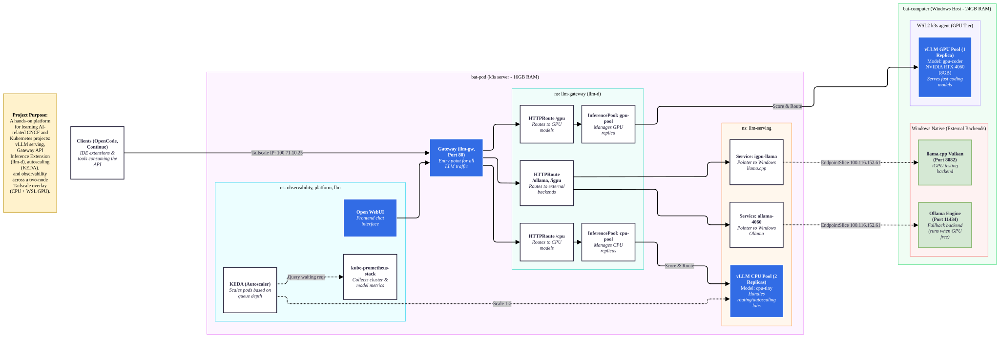

# Personal AI Infrastructure Lab

This repository contains the configuration and low-level design for a two-node Kubernetes (k3s) lab environment designed specifically for hosting, routing, and experimenting with cloud-native AI workloads. The cluster spans a dedicated Ubuntu host and a Windows WSL2 agent connected securely via a Tailscale overlay network.

## 🎯 What We Are Going to Learn

This lab is a hands-on platform to master CNCF and Kubernetes projects focused on AI infrastructure:

* **Cloud-Native AI Serving:** Deploying and managing **vLLM** across heterogeneous compute tiers (CPU and GPU).
* **Intelligent Routing:** Implementing the **Gateway API Inference Extension (llm-d)** to achieve cache-aware routing, model-based routing, and endpoint picking based on queue depth and KV-cache utilization.
* **Autoscaling:** Using **KEDA** to dynamically scale CPU serving pools based on Prometheus metrics (e.g., waiting request queues).
* **Resource & Quota Management:** Using **Kueue** to manage GPU batch job quotas and prevent resource starvation during active serving.
* **External Integrations:** Bridging in-cluster traffic to native Windows endpoints (Ollama, llama.cpp) using Kubernetes Services and EndpointSlices.
* **Observability:** Instrumenting LLM workloads with the `kube-prometheus-stack` and OpenTelemetry for traces, token throughput, and time-to-first-token metrics.

## 🏗️ Architecture & High-Level Design

The architecture utilizes a unified Tailscale network (`100.64.0.0/10`) to bridge the physical nodes. The Gateway acts as the sole entry point, dynamically routing traffic to the appropriate InferencePools or external backends.

## 💻 Hardware & Topology

| Node | Memory | Accelerators | Role |
| :--- | :--- | :--- | :--- |
| **bat-pod** | 16 GB | Intel Iris Xe iGPU | k3s server, CPU compute tier, platform services (Observability, WebUI) |
| **bat-computer** | 24 GB | NVIDIA RTX 4060 (8 GB), Intel iGPU | Windows host; WSL2 Ubuntu running the k3s agent (GPU tier) and native fallback backends |

**Hardware Constraints & Workarounds:**
* The 8GB VRAM on the RTX 4060 is shared with Windows. vLLM is configured with `--gpu-memory-utilization=0.75` to prevent OOM crashes.
* Ollama and vLLM share the same GPU and cannot run concurrently. Scale the vLLM GPU pool to `0` when testing Ollama fallback.
* Cross-node pod communication relies heavily on Tailscale MTU and Firewall allowlists.

## 🚀 Setup & Execution Phases

1. **Network & Cluster Bootstrap:** Establish Tailscale overlay, deploy k3s server on `bat-pod`, and join the WSL2 `bat-computer` agent. Validate Flannel networking across the tailnet.
2. **GPU Enablement:** Deploy the NVIDIA device plugin to the WSL2 agent via `RuntimeClass` and test VRAM allocation inside Kubernetes.
3. **Core Platform:** Deploy Prometheus/Grafana and Open WebUI.
4. **AI Serving Tier:** Deploy vLLM CPU and GPU deployments. Register external endpoints (Windows-native Ollama/llama.cpp).
5. **Gateway & Routing:** Install Gateway API CRDs, Inference Extension, and `llm-d`. Configure intelligent routing to InferencePools.
6. **Advanced Labs:** Incrementally deploy and test KEDA (Autoscaling), Kueue (Batch Quota), KServe, and KubeRay. Ensure strict memory hygiene on `bat-pod` (16GB limit) by tearing down lab stacks between tests.
